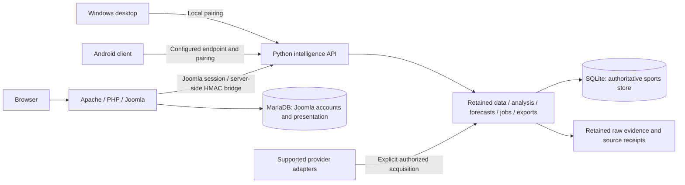
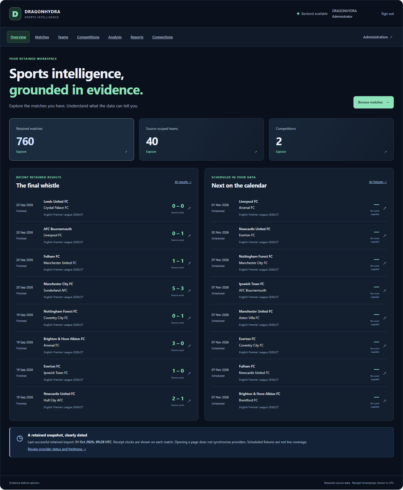

# DRAGONHYDRA

**Sports intelligence with traceable data, explicit uncertainty and a local-first workspace.**

[](https://github.com/chatgptopenaiagi/DRAGONHYDRA/releases/tag/genesis-a9-20261101)
[](pyproject.toml)
[](server/joomla/README.md)

DRAGONHYDRA brings retained sports records, source evidence, statistical analysis and
exports into one workspace. Browse matches, teams and competitions; inspect what an
analysis used; keep unavailable information visible instead of inventing it.

The Windows workstation combines a native desktop client, a private Python server,
and a Joomla sports dashboard with administration. An Android client, Python
packages and a Linux server preparation bundle provide additional access paths.
This is an **unsigned/development prerelease**, with platform-specific verification
and limitations recorded below. No production-stable readiness is claimed.

Current development source adds an authenticated 18-module registry, a Joomla
System Control Center and persisted forecast/evaluation workflows. The frozen
Windows server passed isolated retained-data and restart tests; primary Joomla
deployment is still blocked by canceled Windows elevation. This increment is
**not included in the A9 downloads below**. See the
[module map](docs/architecture/MODULE-MAP.md),
[contracts](docs/architecture/MODULE-CONTRACTS.md) and
[scoped acceptance report](docs/handover/SYSTEM-CONTROL-CENTER-REPORT.md).

## Release downloads

[Open the GENESIS A9 release](https://github.com/chatgptopenaiagi/DRAGONHYDRA/releases/tag/genesis-a9-20261101).
Download `SHA256SUMS.txt` and `RELEASE-MANIFEST.json` alongside your package.

| Download | Purpose and readiness |
|---|---|
| [Windows Workstation Setup](https://github.com/chatgptopenaiagi/DRAGONHYDRA/releases/download/genesis-a9-20261101/DRAGONHYDRA-GENESIS-A9-Workstation-win-x64-Setup.exe) | Complete x64 workstation: desktop, server, Joomla, private web/database runtimes, services and launcher. Development build. |
| [Windows desktop EXE](https://github.com/chatgptopenaiagi/DRAGONHYDRA/releases/download/genesis-a9-20261101/DRAGONHYDRA-0.4.0-alpha.1-Desktop-win-x64.exe) | Standalone native client; requires an existing paired server and WebView2. Download its accompanying notices/build information. |
| [Android ARM64 APK](https://github.com/chatgptopenaiagi/DRAGONHYDRA/releases/download/genesis-a9-20261101/DRAGONHYDRA-0.4.0-alpha.1-Android-arm64-development.apk) | Fresh release-optimized, non-debuggable APK with the established **development certificate**. Fresh emulator install/start verified; connected pairing acceptance was stopped by the user and remains unverified. |
| [Joomla extension ZIP](https://github.com/chatgptopenaiagi/DRAGONHYDRA/releases/download/genesis-a9-20261101/pkg_dragonhydra-0.4.1-dev.2.zip) | Native sports homepage, protected administration, server bridge, assets and Cassiopeia child template. Existing Joomla 6 upgrade/reapplication verified. |
| [Windows server ZIP](https://github.com/chatgptopenaiagi/DRAGONHYDRA/releases/download/genesis-a9-20261101/DRAGONHYDRA-0.4.0-alpha.1-Server-win-x64.zip) | Standalone frozen Python server and runtime. Fresh isolated HTTP/export/restart acceptance. |
| [Python wheel](https://github.com/chatgptopenaiagi/DRAGONHYDRA/releases/download/genesis-a9-20261101/dragonhydra-0.4.0a1-py3-none-any.whl) | Python 3.14 application package; install the `server` extra for HTTP operation. |
| [Python source distribution](https://github.com/chatgptopenaiagi/DRAGONHYDRA/releases/download/genesis-a9-20261101/dragonhydra-0.4.0a1.tar.gz) | Python packaging source; complete cross-platform source is also available from the tag. |
| [Linux A7 preparation archive](https://github.com/chatgptopenaiagi/DRAGONHYDRA/releases/download/genesis-a9-20261101/dragonhydra-linux-dev-8f170de1559b.tar.gz) | Reused immutable server preparation bundle. Python/dependencies required; historical Docker Linux runtime acceptance, **not native WSL/desktop acceptance**. |
| [Complete developer source](https://github.com/chatgptopenaiagi/DRAGONHYDRA/releases/download/genesis-a9-20261101/DRAGONHYDRA-GENESIS-A9-Source.zip) | Exact tagged source, tests, packaging, migrations and documentation; private runtime state excluded. |

Component versions remain independent: workstation `0.4.1-dev.1`, Joomla
`0.4.1-dev.2`, desktop/server/Android `0.4.0-alpha.1`, Python `0.4.0a1`.
A9 is the integration milestone. The release manifest identifies each artifact's
actual source commit, build mode, size, checksum and acceptance scope. Earlier
verified binaries are explicitly identified; their embedded versions are not renamed.

## Product features

- **Browse retained sports data:** real match records, source-scoped teams,
  competitions, scores, statuses and timestamps. Search, filters and pagination.
- **Trace the evidence:** canonical/source identifiers, immutable observations,
  receipt clocks and data availability limits.
- **Use existing statistical analysis:** frequency, Poisson, recency, Elo and
  ensemble outputs where eligible evidence exists. Predictions remain separate
  from results; unsupported forecasts say unavailable.
- **Export findings:** actual JSON, CSV and XLSX files, with protected ownership
  and downloads through the server or Joomla bridge.
- **Manage providers:** show configured status and retained import information;
  the existing protected desktop/API management interface controls keys and supported
  synchronization. Joomla administration provides bridge options and supported
  import/capability actions.
  An adapter being present does not prove a live feed or configured account.
- **Use Joomla natively:** responsive sports homepage, separate site login,
  protected administration, accessible labels/focus and a Cassiopeia child template.
- **Connect desktop/mobile clients:** local pairing for Windows and configurable
  endpoint/pairing settings for Android. Android stores connection secrets through
  its existing Keystore mechanism.
- **Research and evaluate through Python:** point-in-time analysis, forecast and
  evaluation/calibration commands remain available with their required inputs.
  Full evaluation-history management is not implemented in the Joomla frontend.

Optional local-language-model integration exists in source. No model weights,
production model service, public HTTPS deployment or paid provider access is bundled
or claimed operational by this release. Page browsing does not synchronize providers
or start language-model jobs. Explicit Analysis navigation uses existing statistical
calculations; explicit exports create only their supported export jobs.

## System architecture



Joomla owns accounts, permissions, presentation and extension configuration. Python
owns canonical sports records, calculations and durable jobs. The reserved MariaDB
sports schema is not a live replacement for SQLite. Browser code does not receive a
privileged pairing token or bridge secret. Service/owner credentials stay outside
the web root and outside distribution packages.

## Modules

| Module | Responsibility | Source |
|---|---|---|
| Python application | API, records, connectors, models, research, jobs and exports | [`src/dragonhydra`](src/dragonhydra) |
| Joomla component | Native site/admin MVC, bridge, templates, setup and permissions | [`server/joomla`](server/joomla) |
| Desktop client | Tauri 2 shell, installed-profile pairing and external-browser opening | [`client/desktop`](client/desktop) |
| Android client | Flutter UI, configurable endpoint and protected pairing storage | [`android/dragonhydra_mobile`](android/dragonhydra_mobile) |
| Windows workstation | Installer, service, launcher and private runtime orchestration | [`packaging/windows/workstation`](packaging/windows/workstation) |
| Linux preparation | Preflight, explicit installer and user-service template | [`packaging/linux`](packaging/linux) |
| Build/release tooling | Source-locked platform packaging and verification | [`scripts`](scripts) |
| Verification | Unit, transport, installed-runtime and browser acceptance | [`tests`](tests) |

## Installation

### Windows unified workstation

1. Download the Workstation Setup and checksum file from the release.
2. Verify the checksum, close the client belonging to the installation being
   upgraded, then run Setup and approve its Windows elevation request.
3. Retain the existing installation/data/service identity on upgrades. Setup owns
   its private service and chooses available **loopback** ports.
4. Open **DRAGONHYDRA Workstation** from its official shortcut. The native launcher
   waits for the corresponding server and supplies its existing pairing metadata.
5. Open the matching **DRAGONHYDRA Administration** shortcut to access the local,
   masked initial-credential handoff. Choose **Open Joomla**. Open that Joomla
   origin's root homepage and use **Sign in to your workspace** for site access.

Default locations are `C:\Program Files\DRAGONHYDRA` for binaries and
`C:\ProgramData\DRAGONHYDRA` for mutable state. Custom profiles have their service
name in the shortcut title. Do not assume another profile's port or credential is
correct. The verified development homepage is `http://127.0.0.1:18740/`; other
installations discover their own URL through their launcher/status configuration.

Windows 11 x64 is the observed acceptance host. The package declares Windows 10+
x64/.NET Framework 4.8 support. It reuses WebView2; Microsoft's bootstrapper needs
internet if that runtime is missing. Setup is unsigned. Clean-machine and OS-reboot
acceptance remain separate from the documented current-host tests.

### Standalone Windows desktop

Download the EXE and its adjacent build information/notices. It does not install or
replace the server. Use an existing workstation's official launcher, or open the
client's connection screen and pair it with your server. A bare installed client
resolves its matching install marker; a portable client defaults to the standard
workstation's owner-readable client metadata. Keep backend state and credentials.

### Joomla extension

Requires **Joomla 6**, PHP **8.3+** with cURL; the tested stack is Joomla 6.2/PHP8.4.27.
Back up Joomla's database, menu/module/style records and component files first.
Install `pkg_dragonhydra-0.4.1-dev.2.zip` using Joomla's extension installer. It
installs its child template before the component and creates/reuses a native Home
item without deleting sample articles or globally unpublishing modules.

Configure the component's existing Options with the correct numeric-loopback API
base and the protected bridge-secret **file path**. The secret must match that
backend and remain readable only to the actual service identities. The unified
workstation provisions this association automatically. Joomla site and administrator
sessions remain distinct. See [component instructions](server/joomla/README.md).

### Android

The APK targets **ARM64**, Android **7.0 / API24 or newer** (target API36). Allow
installation of this downloaded development APK through your normal Android owner
workflow. It is release-optimized and non-debuggable, but uses the established
**development signing identity**, not a publisher/Play Store certificate.

Configure your own backend URL and pair privately. On a phone, localhost refers
to that phone. Remote access requires your own trusted HTTPS endpoint; this release
provides no public server. Development loopback/ADB routes are separate from normal
remote deployment. Fresh emulator installation, cold launch and Home rendering were
verified. Connected pairing/data navigation, upgrade and restart acceptance were
not completed after native UI automation was stopped by the user.

### Python server

Requires Python **3.14** (`>=3.14,<3.15`). From the downloaded wheel directory:

```sh
python -m venv .venv
# Activate .venv using your platform's normal activation command.
python -m pip install "./dragonhydra-0.4.0a1-py3-none-any.whl[server]"
dragonhydra-server --state ./dragonhydra-state --port 18743 --init-bridge
```

Choose an unused port. The server binds to127.0.0.1 and creates private local
pairing/bridge state. Protect that state and use the generated pairing workflow;
never publish the files or copy credentials into source. `dragonhydra-samples
--directory ./samples` materializes documented public/synthetic CLI examples.
The Windows server ZIP supplies its own frozen runtime and startup instructions.

### Linux server preparation

Extract the A7 archive, provide a compatible Python3.14 environment and its documented
server dependencies, then inspect before installing:

```sh
python3 preflight.py --bundle .
bash install.sh --prefix /absolute/private/dragonhydra --state /absolute/private/dragonhydra-state --apply
DRAGONHYDRA_STATE=/absolute/private/dragonhydra-state DRAGONHYDRA_PORT=18753 /absolute/private/dragonhydra/run-server.sh
```

Use a new prefix and dedicated port. The package installs no OS, Python interpreter,
Joomla stack, model or desktop application. It verifies the installed child
interpreter's dependencies and fails closed rather than reporting false success.
Historical acceptance used isolated **Docker Linux**; native WSL/R8 ownership,
systemd/reboot and Linux desktop deployment are not verified. See
[Linux instructions](packaging/linux/README.md) and the release manifest's provenance.

## Configuration and private data

- Use the owner-restricted first-run handoff for the initial Joomla administrator.
  After changing the password, use the **current** Joomla password; the initial
  handoff does not track later account changes.
- Keep Joomla login, local pairing, bridge authentication and external provider
  keys separate. None is a universal credential for another installation.
- Enter provider keys only in the protected management UI. Provider accounts,
  subscriptions, quotas and data terms remain the owner's responsibility.
- Never commit `workstation.json`, `local-session.json`, bridge-secret contents,
  browser profiles, runtime databases or signing keys. Examples use placeholders.
- Password/provider/pairing changes use runtime configuration, not source edits or
  application rebuilds. Do not rotate credentials just to resolve a wrong endpoint.

## Quick start

**For most Windows users:** install the unified workstation → open its official
shortcut → obtain initial administrator access through the matching Administration
shortcut → open that Joomla origin's homepage → sign in to the site → browse a
retained match → open Analysis or Reports → export a file.

The verified Joomla profile displayed **760 matches,40 source-scoped teams and two
competitions** from its retained backend. These are dated acceptance observations,
not hard-coded totals or a live-feed promise. Empty data and unavailable forecasts
have explicit states. New installations may have different retained data.

## Testing

From an installed development Python3.14 environment:

```sh
python -m unittest -v tests.test_joomla_package tests.test_joomla_frontend_model tests.test_joomla_frontend_setup tests.test_joomla_frontend_templates tests.test_joomla_frontend_transport tests.test_joomla_frontend_menu_contract
```

The frontend passed17requirements through real Joomla site/admin sessions, search,
filters, entity navigation, existing statistical outputs, three actual exports,
logout/fresh login and desktop/narrow layouts. Empty/error states were tested with
the actual templates in an isolated fixture without interrupting services.

The initial browser receipt retains17successful assertions and an external-document
timeout; its hash-linked continuation passes13remaining assertions. Provider-link
checks verify actual new-tab destinations and workspace preservation using controlled
external document responses, not remote provider uptime. See
[frontend report](JOOMLA-FRONTEND-REPORT.md), [recovery report](JOOMLA-RECOVERY-REPORT.md)
and [release report](docs/releases/DRAGONHYDRA-RELEASE-REPORT.md) for exact scopes.
Earlier A6/A7/A8 tests are historical evidence, not automatically rerun against A9.

## Development and reproducible builds

Clone the repository or extract the exact tagged source. Use project-local isolated
build state and the platform's existing toolchain; do not build from private runtime
state. Python requirements are pinned in
[`config/runtime/server-python314.lock.txt`](config/runtime/server-python314.lock.txt).

- **Joomla:** `python scripts/build_joomla.py --output dist/pkg_dragonhydra-0.4.1-dev.2.zip --source-sha <full-source-commit>`.
- **Windows workstation:** build the Joomla package, then use
  `scripts/Build-Workstation.ps1`; a verified existing staging tree can use
  `-RepackageOnly -JoomlaPackagePath <verified-extension.zip>`. Build roots must
  satisfy the script's existing project ownership/path guards.
- **Native desktop/server:** source-locked `scripts/Release-Windows.ps1` uses
  explicit source, toolchain, work, artifact and build-info inputs. Tauri/Rust and
  the Python frozen-runtime dependencies are separate build capabilities.
- **Android:** `scripts/release_android.ps1` requires a clean frozen Git checkout,
  explicit source SHA/version mapping, Flutter, JDK21 and the Android SDK. It uses
  the existing development certificate; production preflight never silently
  substitutes that identity.
- **Python:** `python -m build` uses the pinned `uv_build` backend. The supported
  release helper stages exact source/build metadata and checks an installed wheel
  outside the source tree. See its recorded release commands.
- **Linux:** `scripts/build_linux_bundle.py` and `packaging/linux` produce the
  preparation layout. Read-only preflight and explicit installation are separate.

[Module architecture](docs/handover/ARCHITECTURE.md),
[CLI reference](docs/LEGACY-CLI-REFERENCE.md),
[source-locking procedure](packaging/release/SOURCE-LOCK.md) and
[release manifest](https://github.com/chatgptopenaiagi/DRAGONHYDRA/releases/download/genesis-a9-20261101/RELEASE-MANIFEST.json)
provide deeper detail. Large binaries belong to Release assets, not normal Git history.

## Screenshots

Actual authenticated Joomla workspace:



[Mobile-width workspace](docs/handover/verified-reports/JOOMLA-FRONTEND-MOBILE.png) ·
[Retained match](docs/handover/verified-reports/JOOMLA-FRONTEND-MATCH.png).
Screenshots contain no credential-entry forms or secret values.

## Release notes and known limits

GENESIS A9 consolidates the native Joomla frontend, existing administrator access,
reader-authenticated bridge and exports; the repaired Windows browser-opening and
installed-profile pairing; a newly built Android development APK; standalone server
and Python packages; and immutable Linux A7 preparation with explicit provenance.

Production signing/Android publisher identity, Android connected-session acceptance,
public HTTPS hosting, verified paid/live-provider operation, clean-machine/OS reboot,
Linux desktop/WSL and formal screen-reader/WCAG acceptance remain outside the verified
scope. Statistical outputs are explicitly uncalibrated where the backend reports
that limit. The component/child-template main-landmark consolidation is a documented
accessibility follow-up. Private data and existing installations are preserved.

See [CHANGELOG](CHANGELOG.md) and the release's platform reports for actual new tests,
reused historical evidence, component versions and artifact checksums.
