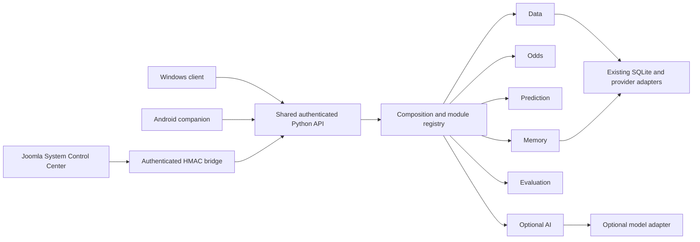
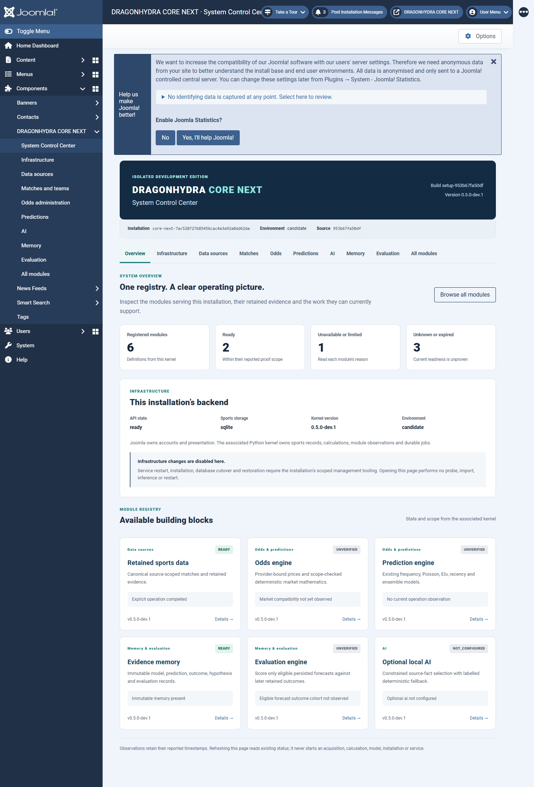
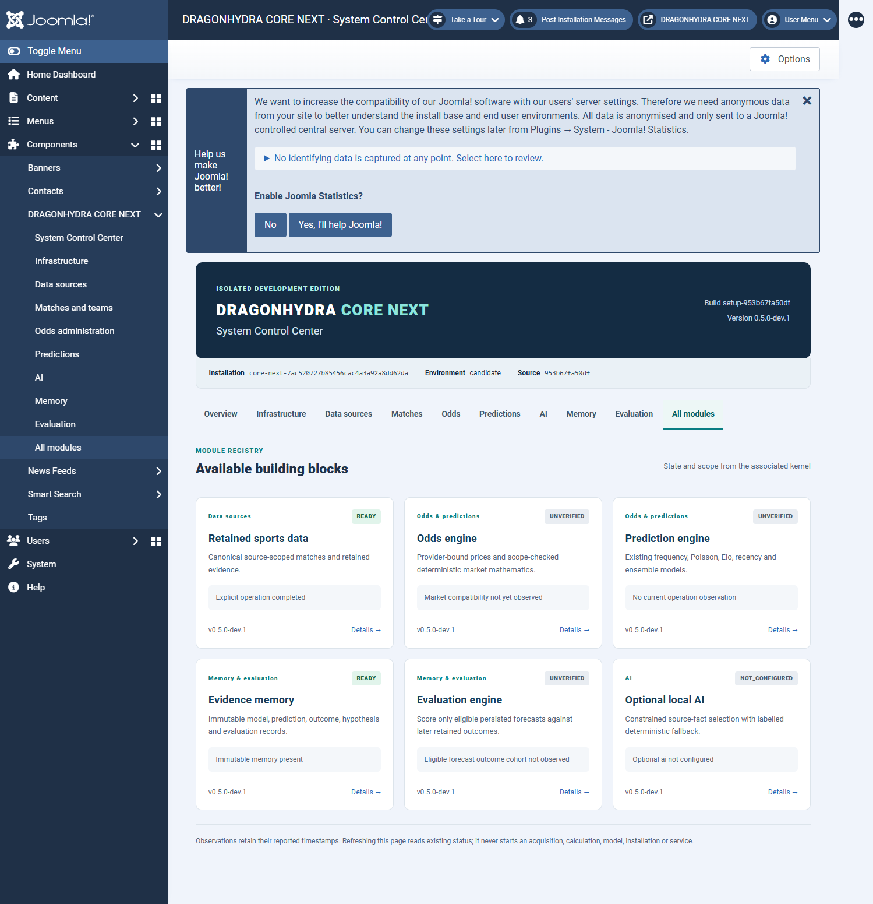
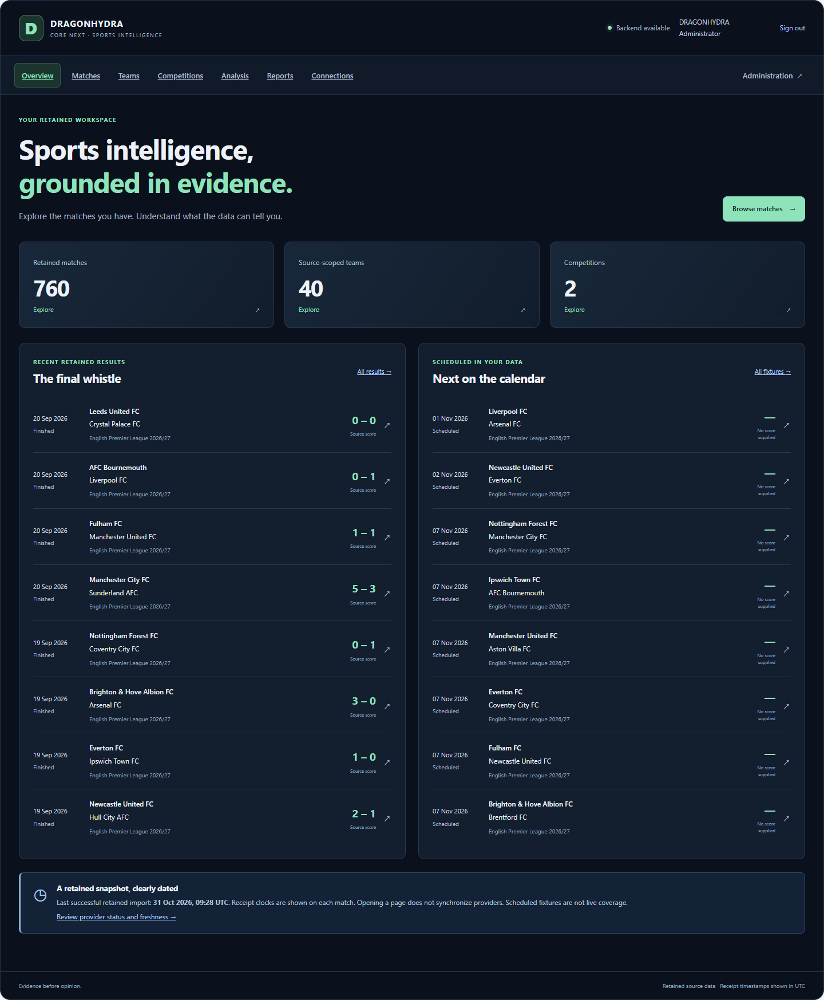

# DRAGONHYDRA CORE NEXT

DRAGONHYDRA is a provenance-aware sports research workstation. It retains real
football fixtures and evidence, offers deterministic analysis and forecasting,
exports JSON/CSV/XLSX, and connects Joomla, a Windows client and an Android
companion to one authenticated Python backend. Stored history alone is not
learning, and a retrospective calculation is not a forecast recorded before an
event.

CORE NEXT is a separate development edition derived from verified
[GENESIS A9](https://github.com/chatgptopenaiagi/DRAGONHYDRA/releases/tag/genesis-a9-20261101),
source `2e6520d5b6a7874881e5de85dbb6ececaef11d8f`. It retains the existing mathematics
and interfaces while reorganizing real application responsibilities into explicit,
injected modules. It is not a new operating-system kernel. Project attribution,
Git history and third-party notices remain part of the original DRAGONHYDRA
repository.

**Published dev.1 evidence:** final-source behavioral comparison: PASS; Linux installed archive: PASS; current-host Windows acceptance: PASS; publication: PUBLICATION_AND_DOWNLOADS_VERIFIED. These historical claims apply only to dev.1; each later increment has its own evidence. Read
[the release report](docs/releases/CORE-NEXT-RELEASE-REPORT.md) for actual status.
The intended release is a separate prerelease, not the stable update channel.

**Current installed checkpoint:** dev.2/source343de81 passed the primary upgrade,
retained forecast/pending-outcome workflow and restart, plus isolated workstation
install/repair/restart/uninstall. It has not been published. Actual browser
acceptance found that the keyboard skip link changed the dashboard's hash route;
the focused source repair preserves the route and table while moving focus.
Dev.3 adds the verified keyboard-safe skip navigation repair to this checkpoint. The shared registry distinguishes six core engines
from twelve supporting components. Existing worker/supervisor checks refresh
bounded, expiring observations without opening Joomla or contacting providers.
The Control Center separates display refresh, local observation and explicit
forecast/evaluation jobs. Standings rendering, regulation-time eligibility and
read-only memory-schema checks have focused repairs. Build, installed-profile
acceptance and publication are recorded separately in the
[current continuation](docs/handover/CONTINUATION-20261102.md); source tests alone
do not by themselves prove the running workstation received an update.

## What changes internally

Before: `Product` combined data presentation, odds, predictions and explanations;
`Jobs.execute` selected handlers directly; Joomla administration included status
placeholders. After: one composition root constructs explicit engine ports,
validates definitions/dependencies and coordinates lifecycle and bounded health.
Actual Product/API/job callers use these boundaries. Canonical mathematical and
storage implementations are reused, not replaced.



A module is an internal responsibility, not another server or database. Apache/PHP
serves Joomla; MariaDB owns Joomla accounts and presentation data; SQLite remains
authoritative sports/evidence storage; the Python service owns the existing durable
job mechanism. There is no second Joomla module-status database or new scheduler.

| Responsibility | Implementation and public boundary |
|---|---|
| Kernel | `src/dragonhydra/kernel/{contracts,composition,registry}.py`: definitions, dependency/schema checks, lifecycle, cached observations and expiry |
| Ports | `kernel/ports.py`: explicit storage, provider, data, model and memory contracts; no unrestricted Product proxy |
| Data | `kernel/engines.py:DataEngine`: retained matches/teams/competitions, source identity and evidence; existing adapters under `connectors/` |
| Odds | `OddsEngine`: existing price/provenance presentation plus `market_signals.py` and `scenario.py`; market scope and incomplete inputs remain explicit |
| Prediction | `PredictionEngine`: existing frequency, Poisson, Elo, recency and ensemble behavior; finished/unsupported fixtures abstain |
| Memory | `MemoryEngine` and `cognition/memory.py`: immutable forecast/model/evidence/outcome references and explicit revisions |
| Evaluation | `EvaluationEngine` and `cognition/evaluation.py`: eligible persisted forecasts, correct outcome scope, Brier/log loss/calibration conventions |
| AI | `AIEngine`, `local_ai*`: optional bounded model adapter and evidence-grounded explanations; unavailable AI does not disable ordinary browsing |
| Jobs | Existing `jobs.py` claims/retries/leases, with explicit composed handler dispatch in `kernel/job_dispatch.py` |
| Joomla | `server/joomla/com_dragonhydra`: retained sports workspace plus native registry-backed Control Center |

See [module map](docs/architecture/MODULE-MAP.md),
[contracts](docs/architecture/MODULE-CONTRACTS.md) and
[old/new caller and ownership map](docs/architecture/REFACTOR-MAP.md).

## System Control Center

The native Joomla administrator component provides overview, infrastructure,
sources, odds/predictions, AI, memory/evaluation, module directory and details.
Every view checks the expected CORE NEXT installation identity before reading
additional backend data. It shows actual state, evidence age, dependencies,
capability restrictions and available owner operations. Actions without a
supported implementation are disabled with a reason.

Authenticated `/dragon/api/v1/modules` and `/modules/{module_id}` are the status
contract. Reads do not acquire providers, run models, create calculation jobs,
install packages or restart services. Evidence expiry does not become a fresh
success. Definitions and installation-specific observations are separate.

Use `?scope=all` for eighteen responsibilities or `?scope=supporting` for twelve;
the default six-engine response is preserved for compatible clients. Green means
recent success within its stated scope, amber a limitation, red an observed
unavailable prerequisite, and neutral unknown/unverified/expired. Capabilities
show their own successful operations; API availability does not verify a model.
The kernel defaults to a 30-second cadence/300-second expiry. Supervisor receipts
expire after 45 seconds and retain that shorter limit. See the
[module contract](docs/architecture/MODULE-CONTRACTS.md) for clocks and permissions.

To update an existing CORE NEXT installation, use the guarded, preview-first
[same-profile upgrade procedure](docs/engineering/CORE-NEXT-UPGRADE.md). Keep its
private consistent backups outside release inputs. Never apply it to GENESIS A9.

Current-host candidate System Control Center: `http://127.0.0.1:18822/administrator/index.php?option=com_dragonhydra`.
Actual authenticated953 screenshots, with captured state/evidence scope:



Captured 2026-11-01T15:31:08.778601+00:00. Actual cached registry after owned full lifecycle; no probe on status read; point-in-time states, not a claim every capability is READY.



Captured 2026-11-01T15:31:09.943460+00:00. Actual cached registry after owned full lifecycle; no probe on status read; point-in-time states, not a claim every capability is READY.



Captured 2026-11-01T15:20:06.558849+00:00. Actual authenticated953UI and retained-data display; registry cards are cached point-in-time observations, not a claim all capabilities are READY.


## Separate installation and first-run access

The Windows unified Setup is the primary delivery. Its default factory creates a fresh CORE NEXT profile and free port assignments. Explicit existing CORE NEXT profiles support repair; installation ID, canonical roots, service, database and ports are checked before mutation. It cannot repair or uninstall an old
DRAGONHYDRA profile. Its service, shortcuts, uninstaller identity, Joomla session,
API cookie and WebView storage are distinct. Android uses
`ai.dragonhydra.corenext.mobile`; the desktop identifier is
`ai.dragonhydra.corenext.desktop`.

For this mission E: was unavailable, so source is
`C:\xampp\DRAGONHYDRA-CORE-NEXT` and isolated runtime/evidence is
`C:\xampp\DRAGONHYDRA-CORE-NEXT-LAB`. The original
`C:\xampp\DRAGONHYDRA` is a read-only reference. Baseline and candidate profiles
have separate GUIDs, application/state/browser roots and fresh credentials. The A9 baseline historically used API18800/Joomla18801/MariaDB18802; its mission-owned reference service was later removed while application/state were retained; the actual candidate assignments are recorded in its generated profile and release report. Provider refresh schedules are disabled
in acceptance. Ports alone do not establish session isolation.

Create a fresh profile with the existing PowerShell7:

```powershell
Set-Location C:\xampp\DRAGONHYDRA-CORE-NEXT
.\scripts\New-CoreNextProfile.ps1 -Environment candidate -SourceCommit <exact-source-commit> -Version 0.5.0-dev.3
```

Use the profile returned by that command with Setup `/PROFILE=...`; review
[packaging instructions](docs/engineering/CORE-NEXT-PACKAGING.md) before installing.
First-run owner access is generated for that installation through the inherited
protected launcher design. Old passwords, provider credentials and pairing files
are not defaults. The standalone desktop client requires its own CORE NEXT state
and paired backend; a missing/mismatched backend is unavailable, never the old
workstation. Cross-origin token handoff from the browser dashboard is disabled.

The server discards inherited `DRAGONHYDRA_*` credential defaults. Only explicitly
scoped `DRAGONHYDRA_CORE_NEXT_*` inputs may feed its existing adapters, process
locally. Linux uses the tested explicit-profile wrapper
`scripts/core_next/linux-server.sh`; historical generic Linux installer entrypoints
fail closed. No systemd/native Linux desktop or production signing claim follows
from an archive build.

## Compatibility and verification

The exact A9 baseline and candidate are compared using the same sanitized,
provenance-recorded SQLite snapshot and fixed clocks/seeds. Real retained counts
and representative IDs are measured, not hard-coded as a requirement. Private
runtime roots, generated job IDs and explicitly volatile fields are normalized
separately from calculations/data. Missing-input/error cases use labelled
synthetic fixtures. Forecasting mathematical source files remain byte-identical;
independent fixed-input golden results cover their outputs.

Historical pre-freeze evidence includes208 broad Python regressions. Final953 source-specific checks include46 focused Windows tests (one platform skip),22 Linux core tests (one platform skip),33 API/export/job parity groups,42 installed API/Joomla/session/AI checks,24 owned lifecycle checks,9 native Windows checks,14 emulator checks and11 Linux installed groups. These scopes are distinct. Consult the release report for final installed,
browser, platform, package and publication outcomes and remaining limitations.

Example tests using the isolated Python environment:

```powershell
$env:PYTHONPATH = (Join-Path (Get-Location) 'src') + ';' + (Join-Path (Get-Location) 'tests')
& C:\xampp\DRAGONHYDRA-CORE-NEXT-LAB\tools-env\Scripts\python.exe -m unittest discover -s tests/core_next
& C:\xampp\DRAGONHYDRA-CORE-NEXT-LAB\tools-env\Scripts\python.exe -m unittest discover -s tests -p test_core_next_server_profile.py
```

Build instructions use the installed toolchain and frozen source, with explicit
lab outputs. See `BASELINE-LOCK.json`, packaging instructions, `RESUME-CODEX.md`
and `ENGINEERING-STATE.json`. Never execute inherited historical acceptance
scripts against their old installation defaults.

## Separate prerelease downloads

The next release identity is **v0.5.0-dev.3-core-next**. Its publication requires
installed-interface, package/privacy and remote-download gates; consult the release
report for the actual result. The links below preserve the already verified dev.1
release while that process completes.

Published prerelease tag:
[v0.5.0-dev.1-core-next](https://github.com/chatgptopenaiagi/DRAGONHYDRA/releases/tag/v0.5.0-dev.1-core-next).
Remote publication and complete asset downloads were verified. Every asset records exact source/build identity, target, size, SHA-256, verification scope and limitations in its release manifest.

- [Unified Windows Setup](https://github.com/chatgptopenaiagi/DRAGONHYDRA/releases/download/v0.5.0-dev.1-core-next/DRAGONHYDRA-CORE-NEXT-0.5.0-dev.1-Workstation-win-x64-Setup.exe)
- [Windows desktop client](https://github.com/chatgptopenaiagi/DRAGONHYDRA/releases/download/v0.5.0-dev.1-core-next/DRAGONHYDRA-CORE-NEXT-0.5.0-dev.1-Desktop-win-x64.exe)
- [Joomla component/template ZIP](https://github.com/chatgptopenaiagi/DRAGONHYDRA/releases/download/v0.5.0-dev.1-core-next/pkg_dragonhydra-0.5.0-dev.1.zip)
- [Windows Python server](https://github.com/chatgptopenaiagi/DRAGONHYDRA/releases/download/v0.5.0-dev.1-core-next/DRAGONHYDRA-CORE-NEXT-0.5.0-dev.1-Server-win-x64.zip)
- [Python wheel](https://github.com/chatgptopenaiagi/DRAGONHYDRA/releases/download/v0.5.0-dev.1-core-next/dragonhydra-0.5.0.dev1-py3-none-any.whl)
- [Python source distribution](https://github.com/chatgptopenaiagi/DRAGONHYDRA/releases/download/v0.5.0-dev.1-core-next/dragonhydra-0.5.0.dev1.tar.gz)
- [Android ARM64 development APK](https://github.com/chatgptopenaiagi/DRAGONHYDRA/releases/download/v0.5.0-dev.1-core-next/DRAGONHYDRA-CORE-NEXT-0.5.0-dev.1-Android-arm64-development.apk)
- [Linux server archive](https://github.com/chatgptopenaiagi/DRAGONHYDRA/releases/download/v0.5.0-dev.1-core-next/DRAGONHYDRA-CORE-NEXT-0.5.0-dev.1-Linux-server-x86_64.tar.gz)
- [Exact source ZIP](https://github.com/chatgptopenaiagi/DRAGONHYDRA/releases/download/v0.5.0-dev.1-core-next/DRAGONHYDRA-CORE-NEXT-0.5.0-dev.1-Source.zip)
- [Checksums](https://github.com/chatgptopenaiagi/DRAGONHYDRA/releases/download/v0.5.0-dev.1-core-next/SHA256SUMS.txt)

Earlier tags/assets and stable release classification are checked during publication. Concurrent external original-project source changes are recorded separately; this mission does not claim that the entire original working tree stayed byte-static.
CORE NEXT is an architectural development prerelease, not a production-stability
claim based on unit tests.

## Frozen source and delivery documentation

All compiled application packages, the tag and source ZIP use `953b67fa50dfa9d705f060f97b8a1af5d317c001`. Later delivery screenshots/reports may be committed separately; that later documentation commit is not presented as the compiled source. See the release report for exact provenance and current acceptance.
