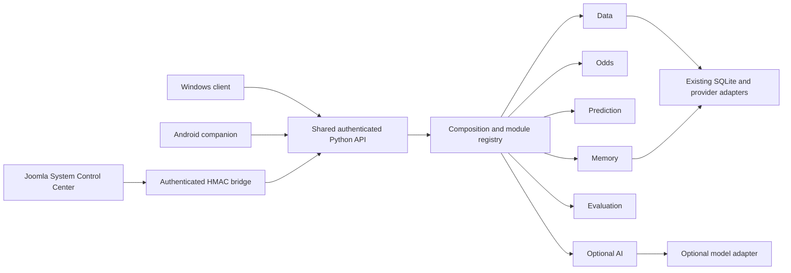

# DRAGONHYDRA CORE NEXT

DRAGONHYDRA is a provenance-aware sports research workstation. It retains real
football fixtures and evidence, offers deterministic analysis and forecasting,
exports JSON/CSV/XLSX, and connects Joomla, a Windows client and an Android
companion to one authenticated Python backend. Stored history alone is not
learning, and a retrospective calculation is not a forecast recorded before an
event.

CORE NEXT is a separate development edition derived from verified
[GENESIS A9](https://github.com/chatgptopenaiagi/DRAGONHYDRA/releases/tag/genesis-a9-20261101),
source `2e6520d5b6a7874881e5de85dbb6ececaef11d8f`. It retains the existing mathematics
and interfaces while reorganizing real application responsibilities into explicit,
injected modules. It is not a new operating-system kernel. Project attribution,
Git history and third-party notices remain part of the original DRAGONHYDRA
repository.

**Development checkpoint:** source/behavioral checks pass; installed candidate
acceptance and publication are gated separately. Read
[the release report](docs/releases/CORE-NEXT-RELEASE-REPORT.md) for actual status.
The intended release is a separate prerelease, not the stable update channel.

## What changes internally

Before: `Product` combined data presentation, odds, predictions and explanations;
`Jobs.execute` selected handlers directly; Joomla administration included status
placeholders. After: one composition root constructs explicit engine ports,
validates definitions/dependencies and coordinates lifecycle and bounded health.
Actual Product/API/job callers use these boundaries. Canonical mathematical and
storage implementations are reused, not replaced.



A module is an internal responsibility, not another server or database. Apache/PHP
serves Joomla; MariaDB owns Joomla accounts and presentation data; SQLite remains
authoritative sports/evidence storage; the Python service owns the existing durable
job mechanism. There is no second Joomla module-status database or new scheduler.

| Responsibility | Implementation and public boundary |
|---|---|
| Kernel | `src/dragonhydra/kernel/{contracts,composition,registry}.py`: definitions, dependency/schema checks, lifecycle, cached observations and expiry |
| Ports | `kernel/ports.py`: explicit storage, provider, data, model and memory contracts; no unrestricted Product proxy |
| Data | `kernel/engines.py:DataEngine`: retained matches/teams/competitions, source identity and evidence; existing adapters under `connectors/` |
| Odds | `OddsEngine`: existing price/provenance presentation plus `market_signals.py` and `scenario.py`; market scope and incomplete inputs remain explicit |
| Prediction | `PredictionEngine`: existing frequency, Poisson, Elo, recency and ensemble behavior; finished/unsupported fixtures abstain |
| Memory | `MemoryEngine` and `cognition/memory.py`: immutable forecast/model/evidence/outcome references and explicit revisions |
| Evaluation | `EvaluationEngine` and `cognition/evaluation.py`: eligible persisted forecasts, correct outcome scope, Brier/log loss/calibration conventions |
| AI | `AIEngine`, `local_ai*`: optional bounded model adapter and evidence-grounded explanations; unavailable AI does not disable ordinary browsing |
| Jobs | Existing `jobs.py` claims/retries/leases, with explicit composed handler dispatch in `kernel/job_dispatch.py` |
| Joomla | `server/joomla/com_dragonhydra`: retained sports workspace plus native registry-backed Control Center |

See [module map](docs/architecture/MODULE-MAP.md),
[contracts](docs/architecture/MODULE-CONTRACTS.md) and
[old/new caller and ownership map](docs/architecture/REFACTOR-MAP.md).

## System Control Center

The native Joomla administrator component provides overview, infrastructure,
sources, odds/predictions, AI, memory/evaluation, module directory and details.
Every view checks the expected CORE NEXT installation identity before reading
additional backend data. It shows actual state, evidence age, dependencies,
capability restrictions and available owner operations. Actions without a
supported implementation are disabled with a reason.

Authenticated `/dragon/api/v1/modules` and `/modules/{module_id}` are the status
contract. Reads do not acquire providers, run models, create calculation jobs,
install packages or restart services. Evidence expiry does not become a fresh
success. Definitions and installation-specific observations are separate.

Current-host candidate URL, once installed:
`http://127.0.0.1:18811/administrator/index.php?option=com_dragonhydra`.
Installed screenshots will be added only after genuine browser acceptance; no
mockup is presented as an application screenshot.

## Separate installation and first-run access

The Windows unified Setup is the primary delivery. It requires an explicit CORE
NEXT installation profile and verifies its installation ID, canonical roots,
service, database and ports before mutation. It cannot repair or uninstall an old
DRAGONHYDRA profile. Its service, shortcuts, uninstaller identity, Joomla session,
API cookie and WebView storage are distinct. Android uses
`ai.dragonhydra.corenext.mobile`; the desktop identifier is
`ai.dragonhydra.corenext.desktop`.

For this mission E: was unavailable, so source is
`C:\xampp\DRAGONHYDRA-CORE-NEXT` and isolated runtime/evidence is
`C:\xampp\DRAGONHYDRA-CORE-NEXT-LAB`. The original
`C:\xampp\DRAGONHYDRA` is a read-only reference. Baseline and candidate profiles
have separate GUIDs, application/state/browser roots, fresh credentials and ports
18800/18801/18802 versus18810/18811/18812. Provider refresh schedules are disabled
in acceptance. Ports alone do not establish session isolation.

Create a fresh profile with the existing PowerShell7:

```powershell
Set-Location C:\xampp\DRAGONHYDRA-CORE-NEXT
.\scripts\New-CoreNextProfile.ps1 -Environment candidate -SourceCommit <exact-source-commit> -Version 0.5.0-dev.1
```

Use the profile returned by that command with Setup `/PROFILE=...`; review
[packaging instructions](docs/engineering/CORE-NEXT-PACKAGING.md) before installing.
First-run owner access is generated for that installation through the inherited
protected launcher design. Old passwords, provider credentials and pairing files
are not defaults. The standalone desktop client requires its own CORE NEXT state
and paired backend; a missing/mismatched backend is unavailable, never the old
workstation. Cross-origin token handoff from the browser dashboard is disabled.

The server discards inherited `DRAGONHYDRA_*` credential defaults. Only explicitly
scoped `DRAGONHYDRA_CORE_NEXT_*` inputs may feed its existing adapters, process
locally. Linux uses the tested explicit-profile wrapper
`scripts/core_next/linux-server.sh`; historical generic Linux installer entrypoints
fail closed. No systemd/native Linux desktop or production signing claim follows
from an archive build.

## Compatibility and verification

The exact A9 baseline and candidate are compared using the same sanitized,
provenance-recorded SQLite snapshot and fixed clocks/seeds. Real retained counts
and representative IDs are measured, not hard-coded as a requirement. Private
runtime roots, generated job IDs and explicitly volatile fields are normalized
separately from calculations/data. Missing-input/error cases use labelled
synthetic fixtures. Forecasting mathematical source files remain byte-identical;
independent fixed-input golden results cover their outputs.

Current source evidence includes208 focused Python regressions,33 API/export/job
semantic comparison groups, Joomla PHP/registry integration, server identity/path
and environment guards, installer ownership/link guards, native state contracts,
and Flutter analysis/tests. Consult the release report for final installed,
browser, platform, package and publication outcomes and remaining limitations.

Example tests using the isolated Python environment:

```powershell
$env:PYTHONPATH = (Join-Path (Get-Location) 'src') + ';' + (Join-Path (Get-Location) 'tests')
& C:\xampp\DRAGONHYDRA-CORE-NEXT-LAB\tools-env\Scripts\python.exe -m unittest discover -s tests/core_next
& C:\xampp\DRAGONHYDRA-CORE-NEXT-LAB\tools-env\Scripts\python.exe -m unittest discover -s tests -p test_core_next_server_profile.py
```

Build instructions use the installed toolchain and frozen source, with explicit
lab outputs. See `BASELINE-LOCK.json`, packaging instructions, `RESUME-CODEX.md`
and `ENGINEERING-STATE.json`. Never execute inherited historical acceptance
scripts against their old installation defaults.

## Separate prerelease downloads

Intended tag:
[v0.5.0-dev.1-core-next](https://github.com/chatgptopenaiagi/DRAGONHYDRA/releases/tag/v0.5.0-dev.1-core-next).
These links become available only after the separate draft passes acceptance and
is published. Every asset will record exact source/build identity, target, size,
SHA-256, verification scope and limitations in its release manifest.

- [Unified Windows Setup](https://github.com/chatgptopenaiagi/DRAGONHYDRA/releases/download/v0.5.0-dev.1-core-next/DRAGONHYDRA-CORE-NEXT-0.5.0-dev.1-Workstation-win-x64-Setup.exe)
- [Windows desktop client](https://github.com/chatgptopenaiagi/DRAGONHYDRA/releases/download/v0.5.0-dev.1-core-next/DRAGONHYDRA-CORE-NEXT-0.5.0-dev.1-Desktop-win-x64.exe)
- [Joomla component/template ZIP](https://github.com/chatgptopenaiagi/DRAGONHYDRA/releases/download/v0.5.0-dev.1-core-next/pkg_dragonhydra-0.5.0-dev.1.zip)
- [Windows Python server](https://github.com/chatgptopenaiagi/DRAGONHYDRA/releases/download/v0.5.0-dev.1-core-next/DRAGONHYDRA-CORE-NEXT-0.5.0-dev.1-Server-win-x64.zip)
- [Python wheel](https://github.com/chatgptopenaiagi/DRAGONHYDRA/releases/download/v0.5.0-dev.1-core-next/dragonhydra-0.5.0.dev1-py3-none-any.whl)
- [Python source distribution](https://github.com/chatgptopenaiagi/DRAGONHYDRA/releases/download/v0.5.0-dev.1-core-next/dragonhydra-0.5.0.dev1.tar.gz)
- [Android ARM64 development APK](https://github.com/chatgptopenaiagi/DRAGONHYDRA/releases/download/v0.5.0-dev.1-core-next/DRAGONHYDRA-CORE-NEXT-0.5.0-dev.1-Android-arm64-development.apk)
- [Linux server archive](https://github.com/chatgptopenaiagi/DRAGONHYDRA/releases/download/v0.5.0-dev.1-core-next/DRAGONHYDRA-CORE-NEXT-0.5.0-dev.1-Linux-server-x86_64.tar.gz)
- [Exact source ZIP](https://github.com/chatgptopenaiagi/DRAGONHYDRA/releases/download/v0.5.0-dev.1-core-next/DRAGONHYDRA-CORE-NEXT-0.5.0-dev.1-Source.zip)
- [Checksums](https://github.com/chatgptopenaiagi/DRAGONHYDRA/releases/download/v0.5.0-dev.1-core-next/SHA256SUMS.txt)

Previous branches, tags, assets and stable release classification remain intact.
CORE NEXT is an architectural development prerelease, not a production-stability
claim based on unit tests.
