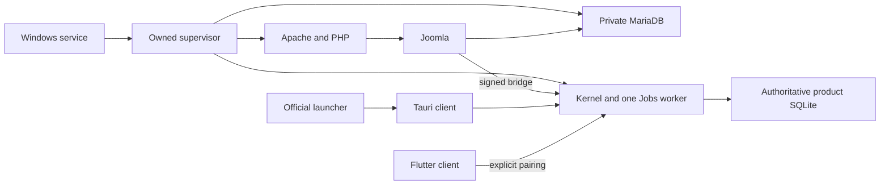

# DRAGONHYDRA module map

Source audit: 2026-11-01. This map describes implementation responsibilities and
contracts. A source entry, installed executable or passing unit test is not proof
that the corresponding installed service has executed the latest source. Runtime
acceptance and package provenance belong to the current engineering report.

The application is an existing modular workstation, rather than a new collection
of independent engines. Python owns retained sports evidence and deterministic
calculations; Joomla owns website identity, permissions and rendering. The Windows
supervisor owns its explicitly configured child processes. Clients consume the
same authenticated `/dragon/api/v1` namespace.

## Runtime and ownership

| Module | Responsibility and canonical source | Runtime / entry point | Inputs → outputs | Dependencies and owned state | Verification and limits |
|---|---|---|---|---|---|
| Apache and PHP | Serve the configured Joomla root; generated configuration in `packaging/windows/workstation/web/manage.php` | Private installed Apache/PHP, launched by `Workstation.ps1`; explicit `httpd.conf` | Loopback HTTP → Joomla execution | Owns web runtime/configuration/logs; does not own sports predictions | Apache `-t -d … -f …`, PHP CLI/web checks and authenticated installation tests; a responding login page proves neither login nor component execution |
| Joomla administrator | Existing component management and protected actions; `server/joomla/com_dragonhydra/admin` | Joomla administrator component, `DisplayController`, `ActionsController`, `View/Dashboard/HtmlView` | Joomla user/session + authorized action → rendered admin page or bounded API job | Joomla accounts, groups, sessions, extensions/menu/component params in MariaDB; `Kernel` reads protected bridge configuration | Joomla recovery and frontend acceptance; `core.manage` and action permissions remain required; no frontend-session shortcut from an administrator cookie |
| Joomla site frontend | Real retained-data overview, matches, entities, analysis, exports and connections; `server/joomla/com_dragonhydra/site`, component media and `tpl_cassiopeia_dragonhydra` | Native Joomla component view and child template | Site session + selected section/match → escaped accessible HTML and downloads | Uses server-side `Kernel`/`ApiClient`; menus/modules/styles configured idempotently by `FrontendSetup` | `tests/test_joomla_frontend_setup.py`, template and HTTP/browser receipts; anonymous shell exposes no private workspace; no direct privileged browser token |
| Joomla bridge | Signed, bounded, loopback-only API transport; `admin/src/Service/ApiClient.php`, site/admin `Kernel.php` | PHP cURL request to configured `/dragon/api/v1` | Method/path/body + Joomla identity/role → signed request and decoded JSON | Protected server-side bridge-secret file and component `api_base`; clock/nonce/HMAC checks in `src/dragonhydra/api.py` | Bridge API tests and authenticated Joomla requests; no arbitrary URL proxy; API timeout/size/redirect bounds remain explicit |
| FastAPI gateway | Authentication, authorization, typed inputs, HTTP errors and shared routes; `src/dragonhydra/api.py`, `api_contracts.py` | `create_app`; `src/dragonhydra/server.py` starts Uvicorn | Local pairing/session or signed Joomla identity + typed request → API response/job | Depends on Product, Jobs and domain modules; local-session and bridge metadata belong to configured state | `tests/test_product_api.py` and route-specific tests; HTTP 200 alone is not application acceptance; local pairing, Joomla login, service HMAC and provider credentials are distinct |
| Module registry/control center | Versioned definitions plus fresh, installation-bound passive observations; `src/dragonhydra/module_registry.py` and Joomla administration view | Authenticated `GET /system/modules` and native component rendering | Definitions + bounded local read observations + owning supervisor receipt → typed module states, dependencies and fixed supported operations | Reads only existing stores/worker and validated short-lived supervisor status; no inventory-wide scan, runtime installer or new controller | `tests/test_module_registry.py`; implemented, configured and ready are separate; operation availability does not bypass its actual route permission/input checks |
| Product service | Canonical UI identities and retained match/team/competition/standings/read operations; `src/dragonhydra/product.py` | `Product(state, source_root)` | Retained source/connector rows + filters → stable IDs and public resource shapes | Uses one configured `core.sqlite3`, connector store and exports directory; source-specific IDs are not cross-provider joins | Product API tests; descriptive standings are not official standings; existing `predictions()` is an ephemeral current calculation and never fabricates a historical forecast |
| Data/evidence ingestion | Preserve raw bytes, hashes, acquisition/receipt clocks, parsed fixtures and quarantine; `public_results.py`, `market_store.py`, `connectors/store.py`, connector adapters | Explicit import/sync jobs or documented CLI | Retained file/approved provider response → immutable evidence and eligible as-of records | SQLite raw sources, captures, receipts, fixture/connector observations and quarantine; protected provider configuration is separate | Store, source and connector tests; capture/import time does not establish contemporaneous live observation; conflicting identities remain unavailable/quarantined |
| Odds engine | Price conversion, implied probability, complete-market margin, proportional margin removal, movements and compatible comparisons; `market_signals.py`, `scenario.py` | Pure calculation over retained eligible quotes | Fully scoped quotes and cutoff → metrics with evidence IDs or explicit unavailable reasons | Reads retained market evidence; owns no new sports store and performs no provider requests | `tests/test_market_signals.py`, `test_market_store.py`, `test_research.py`; complete market and settlement/line/time compatibility required; implied prices are not true chances |
| Prediction engine | Existing frequency, Poisson, Elo, recency and transparent ensemble; `cognition/models.py`, `research.py`, `cognition/adaptation.py` | `models.forecast`; existing CLI `train`/`predict` | Same-source/competition eligible inputs + unplayed target + cutoff/config → normalized estimates and uncertainty | Raw resolver verifies evidence; adaptive weights require comparable retained evaluations | `test_cognition_models.py`, `test_cognition_adaptation.py`, `test_forecast_cli.py`; research models are uncalibrated; no demonstrated live performance; no unknown provider mapping |
| Workflow adapter | Bind an explicitly selected Product match to existing forecast/memory/evaluation operations; `system_workflow.py` | Explicit `forecast`/`evaluation` Jobs; read-only `match_history` | Match ID + durable job ID → retained model/prediction receipts or pending result/history | Reuses Product DB and cognition schema; never imports, syncs, runs local AI or creates another engine | `tests/test_system_workflow.py`; finished targets cannot receive new prospective forecasts; unsupported connector sources abstain; absent later outcome remains pending |
| Cognitive memory | Append-only provenance and original receipt clocks for models, predictions, outcomes, tasks, hypotheses and evaluations; `cognition/memory.py` | Existing `record_*`, `as_of`, `resolve_evidence` | Validated draft/evidence → immutable record, fingerprint and receipt | `cognitive_records`, `cognitive_receipts`, immutable update/delete triggers in the same SQLite DB; created only on explicit first workflow write in the product integration | `test_cognition_memory.py`; persistence is traceability, not a claim of learning; receipt transaction-boundary visibility remains explicitly unverified |
| Evaluation engine | Match earlier stored predictions with genuine later outcomes; proper scores, coverage, exclusions, revisions and historical holdout; `cognition/evaluation.py` | `evaluate_observed`, `chronological_holdout`, `memory.record_evaluation` | Eligible immutable memory or scoped retained history → scores and lineage, or null/unscored reason | Uses source/competition/model/version/period/settlement scope; persisted metrics recomputed from authoritative records | `test_cognition_evaluation.py`; present-knowledge holdout is distinct from operational performance; base-model metric persistence supports `models.NAMES`; no operational score without an earlier retained forecast |
| Optional local AI | Bounded, explicitly requested grounded explanation; `local_ai.py`, `local_ai_context.py`, `local_ai_service.py`, `local_ai_settings.py` | `local_explanation` job | Frozen evidence package/manifest + protected configured endpoint → validated explanation or deterministic fallback | Server-side endpoint/key and existing context records; no browser-supplied arbitrary endpoint | Local AI/context/package tests; disabled/unconfigured is a valid unavailable branch; neither inference nor accepted wording changes official result/forecast probabilities |
| Source context | Append-only evidence-bound contextual documents and validated lineage; `source_context.py`, `connectors/statsbomb_context_jobs.py` | Explicit context job and read-only context routes | Retained parent observation/documents → context snapshot | Same core SQLite evidence and source hashes; no generated facts substituted for evidence | Context store/job and package/3 tests; context must match the selected source observation and cutoff |
| Jobs and update outbox | Durable queue, owner/idempotency binding, bounded claims/retries/cancellation and committed updates; `jobs.py` | One existing worker thread per Product server | Authorized fixed kind/payload → persisted job status/result/error | `product_jobs`, `product_updates`, sessions/nonces in same DB; provider scheduler uses configured intervals | Product job/API and connector scheduling tests; a succeeded evaluation job may honestly contain `status: pending`; a lost/partial calculation is not reported as a complete forecast |
| Provider scheduler | Run due, explicitly configured connectors using the existing worker; `connectors/service.py` and `Jobs.run_once` | Existing worker's due scheduling, not a second daemon | Enabled connector interval/config → bounded owned connector job | Existing settings, vault and retained attempt records | Connector tests; module status reads must not trigger synchronization, quota use or model runs |
| Windows service/supervisor | Own private MariaDB, kernel and Apache lifecycle, endpoint/config propagation and readiness observations; `DragonhydraService.cs`, `Workstation.ps1` | One configured Windows service → owned PowerShell supervisor | Protected workstation config → owned children and sanitized status | Installation/state directories and configured ports; child PIDs need not equal service PID; stops only owned children | Workstation install/upgrade/restart receipts and focused tests; one profile's ready state says nothing about another profile; observations expire and TCP checks alone are limited |
| Windows launcher/Tauri | Open corresponding service-backed local client or Joomla administration; safe external browser links; `DragonhydraLauncher.cs`, `client/desktop/src-tauri` | Official shortcut → launcher → Tauri/WebView | Installed endpoint/session metadata → paired local app; validated HTTP(S) URL → default browser | Service-specific state and WebView profile; official opener plugin and capabilities | External-link and client-state tests plus installed browser checks; no token replacement or navigation to unrelated responding backend |
| Flutter Android | Mobile interface for an explicitly paired configured server; `android/dragonhydra_mobile/lib` | Flutter application `main.dart`, server connection service | User pairing/server config + shared API → mobile views | Mobile app state; does not own workstation services, MariaDB or backend authority | Android analyzer/widget/server-connection tests and build report; emulator launch is distinct from successful physical-device pairing and data navigation |
| SQLite / MariaDB | Preserve their established division of authority | Product state `core.sqlite3`; private configured MariaDB | Product evidence/jobs/cognition versus Joomla users/content/config | MariaDB `dragonhydra_core` name alone does not transfer SQLite authority; optional `mariadb_migration.py` is a separate explicit workflow | Consistent SQLite backups and targeted MariaDB logical backups; copied live storage files are not a verified database backup |

## Startup dependencies versus application flow

The startup dependency graph is finite. The owning supervisor starts its database,
kernel and Apache, verifies readiness and copies endpoint/session metadata into
its client state. Joomla's server-side bridge targets that installation's
configured kernel. Tauri/Flutter do not start competing backend coordinators.

This graph is not a repeated training loop. Explicit operational commands form a
separate workflow: selected retained fixture → existing forecast → immutable
model and prediction records → Joomla history → later retained outcome → matched
evaluation → retained evaluation history. A missing outcome, compatible market
or optional AI runtime ends that branch with an explicit unavailable/pending
state. It does not cause a fabricated result, background provider sync or endless
retry.

## Current verification boundary

The focused source gate passed 120 tests in 8.763 seconds, using the existing
project Python environment and `PYTHONPATH=src`: `tests.test_system_workflow`,
`test_market_signals`, `test_cognition_models`, `test_cognition_memory`,
`test_cognition_evaluation`, `test_cognition_commands`,
`test_cognition_adaptation`, `test_product_api` and `test_module_registry`. Unit fixtures intentionally use
fictional records and controlled later clocks to exercise the full outcome
branch; they do not establish a real completed future match or a historical
prediction in the workstation's retained data.

An additional fresh isolated Product-state execution explicitly imported the two
existing bundled acquisition receipts: 760 retained records before and after.
For Ipswich Town FC–AFC Bournemouth on 2026-11-07, source
`openfootball-2026-27-en1.json`, match ID
`11b9878fcff481ce5952b61d6df9dda8fd43ac21b29ae675aec8f2a1d3d40b1b`,
the adapter stored five model records and five predictions from 50 eligible
training records. History returned five/five/zero/zero models, predictions,
outcomes and evaluations. Explicit evaluation returned
`pending / LATER_RETAINED_OUTCOME_UNAVAILABLE`, correctly. That temporary-state
probe exited zero and did not alter the primary installation. Actual installed
API/Joomla acceptance is separately recorded by the coordinator.

The affected Windows kernel was then built with the existing cached PyInstaller
pipeline and no dependency installation. Scoped source content hash is
`6fac95de8b49afeafaf37c61d901c3ce62ed432ff96f66ece9d82e083dbed88c`
(70 inputs); the new private-runtime payload has 710 files. Executable:
`build/connections/system-control-center-20261101-kernel/dist/DRAGONHYDRA-Server-x64/DRAGONHYDRA-Server.exe`,
8,070,167 bytes, SHA-256
`e0e966714912dbdb478d71c80a2d6c698bbe86a1cd0cd31a5f69ab1c8752cd48`.
Build and existing frozen-server six-group / connector 22-group verifiers exited
zero. The new `tests/installation/system_control_frozen.py` passed nine groups:
authenticated passive 18-module registry, schema-free initial history, explicit
760-record import, real selected forecast persistence, honest pending evaluation,
graceful shutdown and same-state restart with pairing, memory IDs and durable job
idempotency preserved. That frozen test selected Nottingham Forest FC–Manchester
City FC on 2026-11-07 and stored five models/predictions from 50 eligible inputs.
Both shutdowns exited zero. Its receipt is
`build/connections/system-control-center-20261101-kernel/system-control-check/system-control-frozen.json`.
This is current-host isolated executable verification, not Joomla browser,
installed service replacement or clean-machine acceptance.

No new runtime, database server, model package or background service was added by
this architectural integration. Existing capability inventory and source were
consulted; the requested `E:\GENESIS-10\AGENTS.md` and `SESSION-HANDOFF.md` were
absent in this session, so no unrelated GENESIS-10 implementation was assumed.
