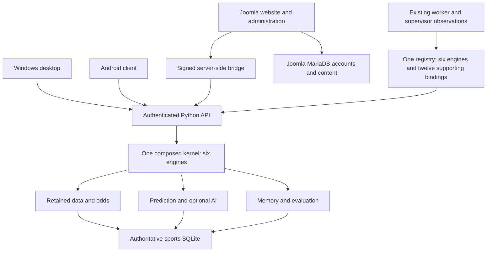

# CORE NEXT module ownership

The composition root is `src/dragonhydra/kernel/composition.py`. It binds real
application engines, their narrow ports and the existing canonical domain code.
`Product` remains a compatibility facade. Registration itself establishes no
runtime readiness or data availability.

| Module | Actual engine owner | Canonical algorithms/storage reused | Required / optional dependencies |
|---|---|---|---|
| data | `kernel/engines.py:DataEngine` | `public_results`, `connectors.store`, existing source-scoped identities | sqlite_storage |
| odds | `kernel/engines.py:OddsEngine` | `market_signals`, `scenario`, retained connector quote provenance | data |
| prediction | `kernel/engines.py:PredictionEngine` | `cognition.models` and retained-source resolver | data / memory for explicit persistence |
| memory | `kernel/engines.py:MemoryEngine` | `cognition.memory` immutable records and receipts | data |
| evaluation | `kernel/engines.py:EvaluationEngine` | `cognition.evaluation`; existing memory persistence validation | memory / prediction implementation may be absent when evaluating older records |
| ai | `kernel/engines.py:AIEngine` | frozen `local_ai`/`local_ai_context` packages, `local_ai_service`, protected settings | data; external configured model is optional |

`domain.py` supplies shared pure API/identity/clock definitions. Engines receive
`ApplicationContext`, `StoragePort`, `ProviderReadPort`, `DataReadPort`,
`ModelPort` and `MemoryPort` as applicable. They neither import Product nor use
an unrestricted service locator. Existing mathematical modules are unchanged.
Composition owns concrete adapter selection; independently injected test ports
exercise engines without constructing Product or Kernel.

The durable queue remains `jobs.py`. `kernel/job_dispatch.py` receives explicit
callbacks, dispatching the same supported job kinds. Claim generation, fencing,
lease/heartbeat, retries, cancellation, scheduler and publication transactions
remain in their existing owner. No second queue, database, provider schedule or
authentication system was introduced.

## Registry inventory reconciliation (dev.2)

The installed dev.1 kernel registered six engines. The earlier GENESIS candidate
registered eighteen broader responsibilities in a different implementation. This
was a source/build inventory difference, not Joomla hiding twelve installed
engines. Dev.2 keeps six engines and adds twelve **supporting bindings to the same
ModuleRegistry**. No extra service or empty engine is created. The compatibility
default `GET /dragon/api/v1/modules` still returns six engines; `?scope=all`
returns eighteen and `?scope=supporting` returns twelve. Every response carries
the same installation/build identity and `inventory` totals.

| Supporting ID | Responsibility / canonical source | Runtime owner and dependencies | Data / configuration | Evidence limits |
|---|---|---|---|---|
| web_server | Apache/PHP; `packaging/windows/workstation/Workstation.ps1` | Owning supervisor and Apache children | Site files; explicit httpd.conf/PHP configuration | PID plus bounded HTTP reachability, not all PHP extensions |
| joomla_administration | Users/ACL/component; `server/joomla/com_dragonhydra/admin` | Joomla; web_server, mariadb_storage, api_server | MariaDB accounts/content; Joomla configuration | Anonymous login bootstrap is limited evidence; genuine login is separate acceptance |
| joomla_website | Sports presentation; `server/joomla/com_dragonhydra/site` | Joomla; web_server, api_server | Sessions/menu presentation; bridge configuration | Read-only loopback reachability does not prove every protected page |
| api_server | Typed authentication/API; `src/dragonhydra/api.py` | This ASGI process | Sessions/nonces; profile endpoint identity | In-process lifecycle, not client/device acceptance |
| sqlite_storage | Authoritative sports/jobs/research; `src/dragonhydra/product.py` | Configured SQLite; no Joomla database substitution | core.sqlite3; profile state root | Bounded read-only schema access; cognitive triggers checked separately |
| mariadb_storage | Joomla account/content storage; `packaging/windows/workstation/web/manage.php` | Owned MariaDB child | Profile-specific schema/prefix/endpoint | Owned listener plus Joomla bootstrap, not a full schema certification |
| durable_jobs | Queue/lease/idempotency; `src/dragonhydra/jobs.py` | Existing Python worker; sqlite_storage | product_jobs/updates; existing worker configuration | Thread plus read-only queue counts; no job submitted by observation |
| provider_scheduler | Due enabled schedules; `src/dragonhydra/connectors/service.py` | Existing worker; durable_jobs | connector_settings interval/next_due; protected provider settings | No provider request; no schedules is distinct from an unreadable table |
| runtime_supervisor | Profile child ownership/health; `packaging/windows/workstation/Workstation.ps1` | Owning Windows service and kernel observer | Profile-bound runtime receipts | Exact installation/build/API PID and expiring heartbeat; no service-control authority granted to Joomla |
| windows_desktop | Launcher/pairing/external browser; `client/desktop` | Owner Tauri process; api_server | Client pairing/WebView state; endpoint metadata | Files are unverified until interactive acceptance |
| android_client | Shared mobile contract; `android/dragonhydra_mobile` | External Flutter device; api_server | Mobile pairing and explicit endpoint | Source/APK existence does not verify a device |
| packaging_recovery | Reproducible install/repair; `scripts/Build-CoreNextWorkstation.ps1` | Scoped management tools | Build manifests/profile identities | Metadata remains unverified until package/install acceptance |

`kernel/supporting.py` owns these definitions and bounded adapters. Each definition
declares the actual build version, source reference, operations, owner, domains and
tests. Runtime observations stay in the profile, not in version-controlled module
definitions. Joomla consumes the shared API, never a second status database.

The real forecast workflow uses `kernel/workflow.py`: retained source identity and
versions → explicit cutoff/model run → immutable prediction receipts → Joomla
history/readback → later eligible outcome or a labelled pending evaluation. Four
base models plus one ensemble are five outputs, not five independent models.
Persisted ensemble evaluation is outside the existing memory writer's supported
model set; it is reported as a limitation rather than silently inventing a schema.

Source, profile and live state are separate. This edition uses its independently
validated installation profile, private lab state, unique installation-scoped API
cookie and existing Joomla HMAC identity mechanism. Original DRAGONHYDRA paths,
services and accounts are never a backend fallback.
