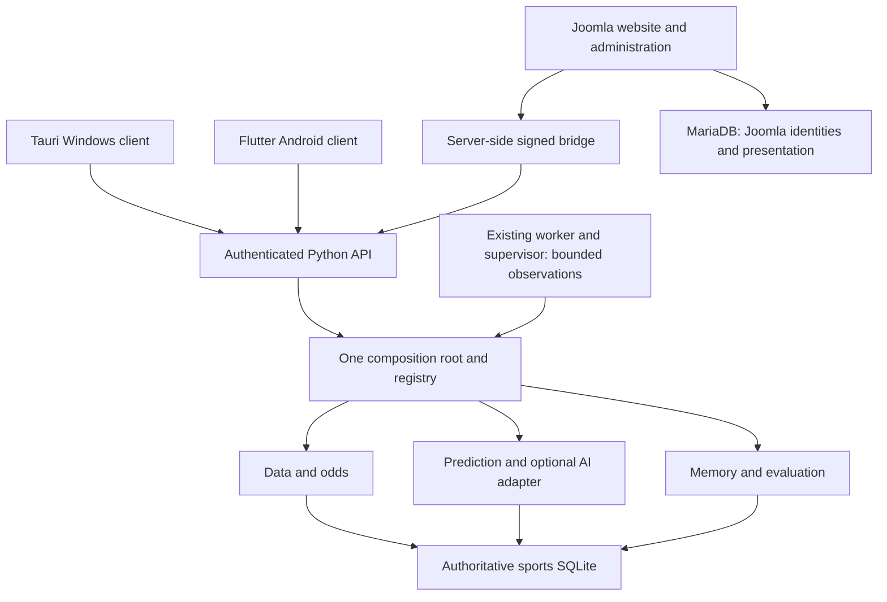

# Reconciled DRAGONHYDRA architecture

The implementation authority is the existing CORE NEXT composition root. The
[module map](MODULE-MAP.md) and [contracts](MODULE-CONTRACTS.md) define its six
engines and twelve supporting responsibilities. Eighteen entries do not mean
eighteen processing engines or services.

The job worker already owns acquisition, forecast, evaluation and export jobs.
Class A status reads consume cached observations. Class B local checks are bounded
and create evidence only. Class C provider/model/research operations require
explicit authorized requests. No additional queue, observation daemon, status
database or generic URL proxy is introduced.

Profile metadata owns endpoint, state, service and build binding. Joomla sessions,
local pairing, bridge HMAC and external provider credentials remain distinct.
Credentials stay in private provisioning/state, never registry output or browser
bundles. A service identity statement establishes only its stated binding scope;
it grants no Windows control privileges.

CORE NEXT is integrated independently. Original Joomla18740/backend18744, other
profiles, published A9 and dev.1 remain preservation references. The active
18822/18821 installation must be upgraded through its own supported controller,
after an isolated install/recovery gate and a consistent backup.
